<!-- SPDX-License-Identifier: MIT -->
<!-- Copyright (c) 2026 The RadioFoundry Authors -->

# Showcase: Home clock and the Cryo / Ember Cryo themes

Screenshots of two RadioFoundry UI features that are not in `main`. Every image is a **simulator render**
(the host UI gallery in `docs/ux/screens`), not a photo of a radio. The sample channels and names are test data.

The code is in the branch `feat/clock-plus-themes` of this fork (clock plus themes combined, on top of an
`upstream/main` merge from November 2026). Neither feature has a pull request open.

## Home clock

Settings > Display > **Clock** (Off, 24 hour, 12 hour) and **Time zone** (UTC-12 to UTC+14). The time of day shows in the
top status line, from the GPS time. Nothing is drawn until the time is known, and only where the line has room.

| | |
|---|---|
|  | 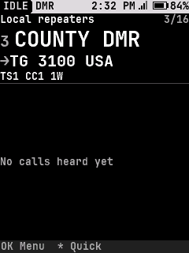 |
| 24 hour, idle | 12 hour (shown as `2:32P`) |
|  |  |
| Receiving a call | Dual watch |
|  | |
| Clock on, time not known yet: nothing drawn | |

Small screens use a smaller font for the time where the usual one does not fit, and there may still be no room. This is the 128x64 screen (no room, so no time) and the 160x128 dual watch screen:

| 128x64 | 160x128 dual watch |
|---|---|
| 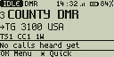 | 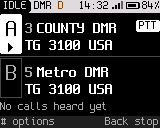 |

## Themes

Settings > Display > **Theme**: Dark, Light, High contrast, **Cryo** and **Ember Cryo**. Cryo is teal-black with
ice-white text and a pale ice status bar. Ember Cryo is the same ground with cream and copper text and an amber status
bar. Color screens only. Left to right: Dark (the default), Cryo, Ember Cryo.

| Dark | Cryo | Ember Cryo |
|---|---|---|
|  |  | 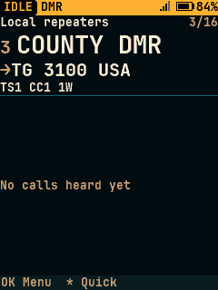 |
|  |  | 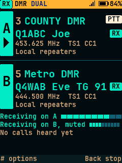 |
|  | 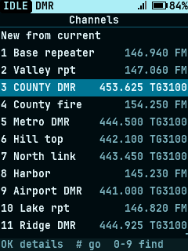 |  |
| 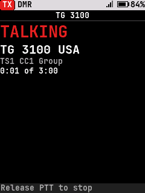 |  | 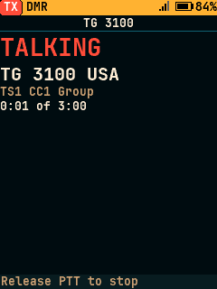 |
| 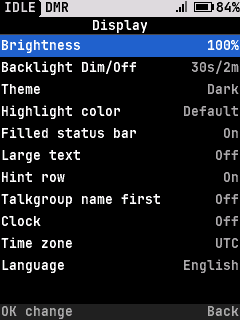 | 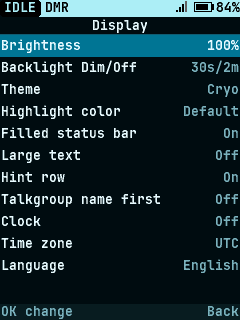 | 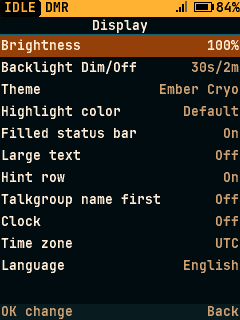 |

Rows: Home, dual watch, channel list, transmitting, the Display settings page.

## Status

- The project's docs list the clock as checked with the GPS time on one radio. These images come from the simulator only.
- The themes keep their setting in a settings byte that upstream `main` now uses for something else, so they need rework before any pull request.
- Not merged and not proposed upstream. The project's main repository is
  [RadioFoundry/RadioFoundry](https://github.com/RadioFoundry/RadioFoundry).
