<!-- SPDX-License-Identifier: MIT -->
<!-- Copyright (c) 2026 The RadioFoundry Authors -->

# Showcase: Home clock, RTC, Scan pulse and Heartbeat, and the Cryo / Ember Cryo themes

Screenshots of RadioFoundry UI work that is not in `main`. Every image is a **simulator render**
(the host UI gallery in `docs/ux/screens`), not a photo of a radio. The sample channels and names are test data.

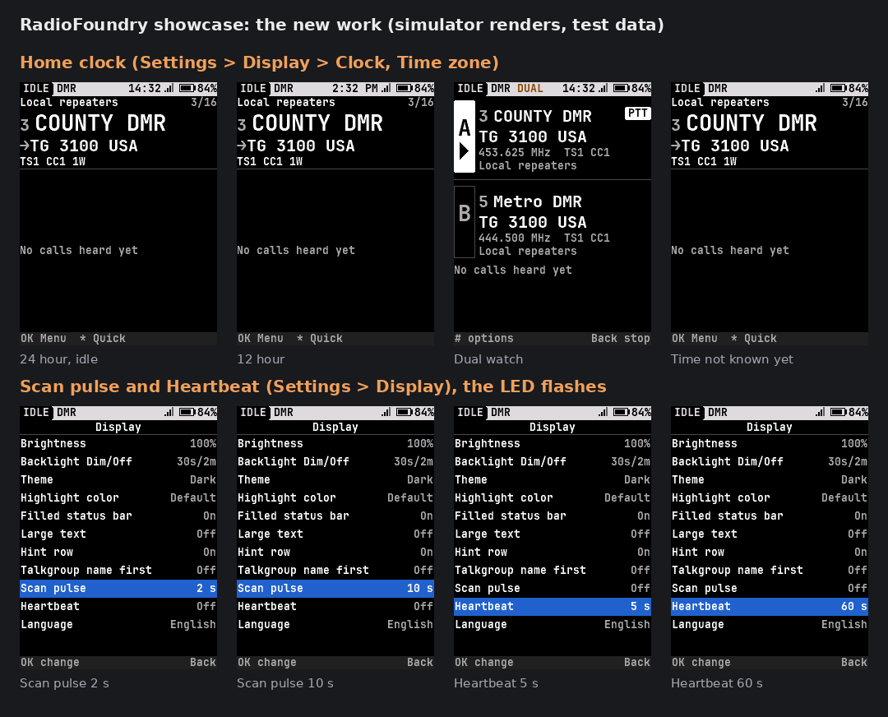

| Feature | State |
|---|---|
| Home clock | In the branch `feat/clock-plus-themes` of this fork. No pull request. |
| Cryo and Ember Cryo themes | Same branch. No pull request. |
| Hardware clock (RTC) driver | [RadioFoundry #1136](https://github.com/RadioFoundry/RadioFoundry/pull/1136): approved by a maintainer, not merged yet. |
| Scan pulse and Heartbeat (LED) | [RadioFoundry #1090](https://github.com/RadioFoundry/RadioFoundry/pull/1090): open, under review. |

## Home clock

Settings > Display > **Clock** (Off, 24 hour, 12 hour) and **Time zone** (UTC-12 to UTC+14). The time of day shows in the
top status line, from the GPS time. Nothing is drawn until the time is known, and only where the line has room.

| | |
|---|---|
|  |  |
| 24 hour, idle | 12 hour (shown as `2:32P`) |
| 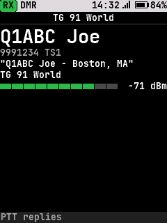 | 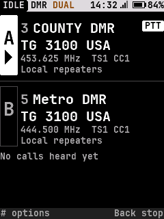 |
| Receiving a call | Dual watch |
|  | |
| Clock on, time not known yet: nothing drawn | |

Small screens use a smaller font for the time where the usual one does not fit, and there may still be no room. This is the 128x64 screen (no room, so no time) and the 160x128 dual watch screen:

| 128x64 | 160x128 dual watch |
|---|---|
|  |  |

## RTC (hardware clock)

There is no screen for it: it is a driver. The radio's own clock keeps the time while the radio is off, and the debug
link reads and sets it (`rfoundry_debug.py rtc get` / `rtc set now`). It is built behind `CONFIG_RTC` (it follows
`CONFIG_DEBUGLINK`), written for the DM-32UV and shared with the DM-1801 Pro (untested there). It was checked on a
DM-32UV: set, counting, and through a power cycle with the battery in. The Home clock above takes its time from the GPS.
Having the clock read the RTC at power-on, before a GPS fix, is built in a local branch that is not published, so it is
not in these images.

## Scan pulse and Heartbeat

Two settings under Settings > Display, both off by default. The green LED flashes for 50 ms every few seconds, so a radio
with its screen off still shows what it is doing:

| Setting | Values | What it does |
|---|---|---|
| Scan pulse | Off, 2 s, 5 s, 10 s | one flash every n seconds while a scan or dual watch runs |
| Heartbeat | Off, 5 s, 10 s, 30 s, 60 s | two quick flashes, 80 ms apart, every n seconds while the radio is on and idle |

A reception (green), a transmission (red) and the other signals always win over a flash. With only the Heartbeat set, a
scan shows the Heartbeat. All states of the two rows:

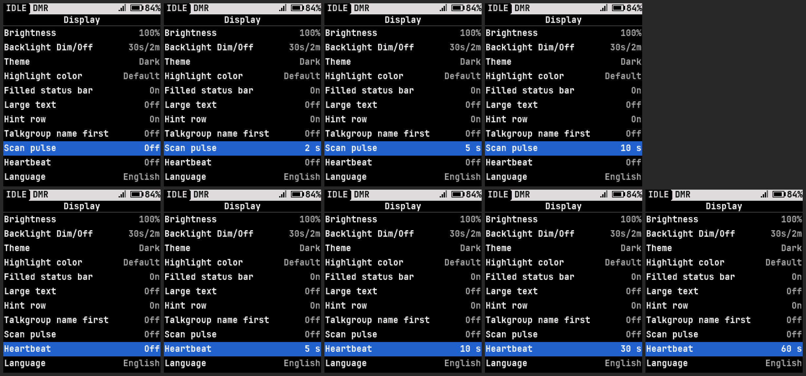

Tried on a DM-32UV by eye, not on other radios. The details and the review are in
[#1090](https://github.com/RadioFoundry/RadioFoundry/pull/1090).

## Themes

Settings > Display > **Theme**: Dark, Light, High contrast, **Cryo** and **Ember Cryo**. Cryo is teal-black with
ice-white text and a pale ice status bar. Ember Cryo is the same ground with cream and copper text and an amber status
bar. Color screens only. Left to right: Dark (the default), Cryo, Ember Cryo.

| Dark | Cryo | Ember Cryo |
|---|---|---|
| 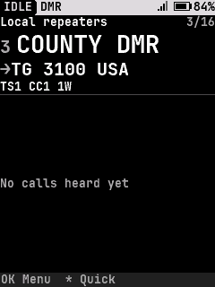 | 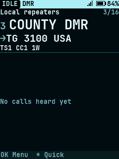 |  |
| 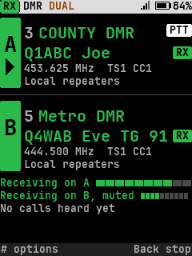 | 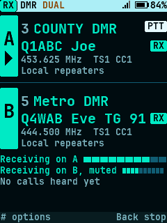 |  |
| 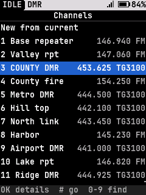 |  | 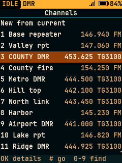 |
|  | 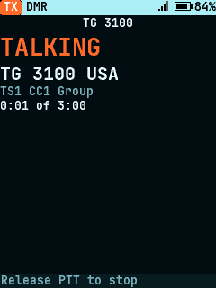 |  |
|  |  |  |

Rows: Home, dual watch, channel list, transmitting, the Display settings page.

## Status

- The project's docs list the clock as checked with the GPS time on one radio. These images come from the simulator only.
- The themes keep their setting in a settings byte that upstream `main` now uses for something else, so they need rework before any pull request.
- The clock and themes are not merged and not proposed upstream. The RTC driver and the LED settings are open pull requests
  (above). The project's main repository is [RadioFoundry/RadioFoundry](https://github.com/RadioFoundry/RadioFoundry).
